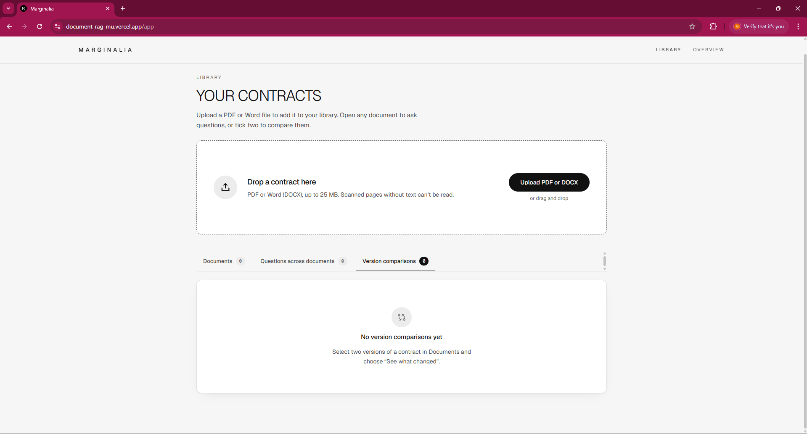
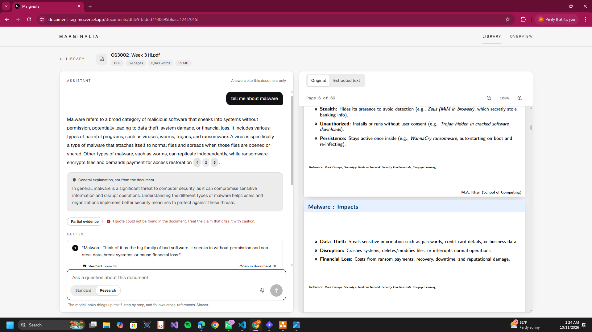
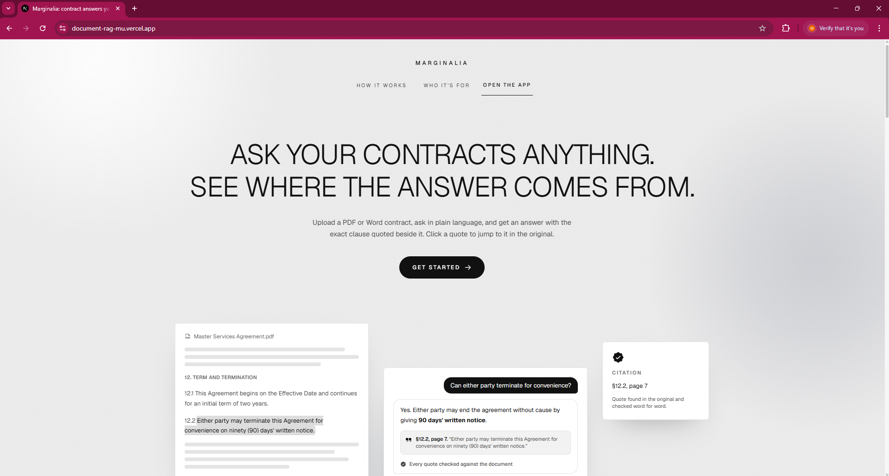
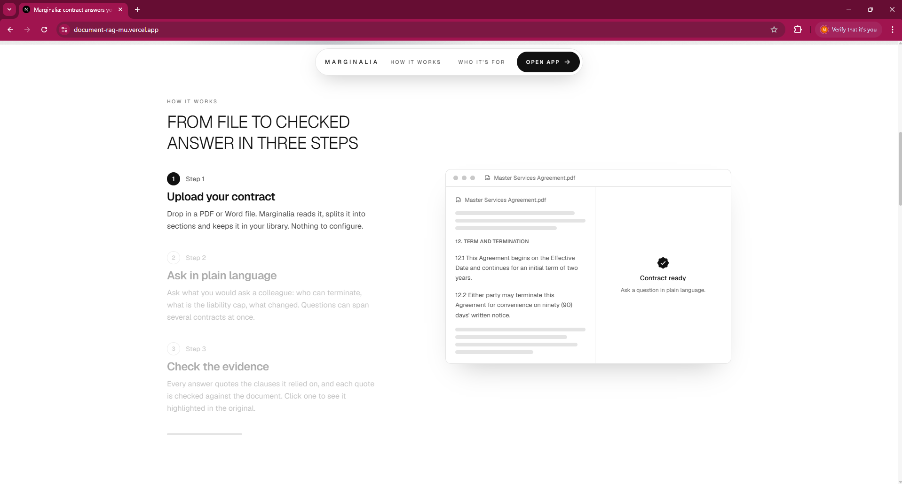

# Marginalia

A web app for analysing contracts. Upload a PDF or Word file, ask questions in a chat, and get answers
backed by quotes that the app has **checked against the document itself** before showing them. Click a
quote and the original page opens with the passage highlighted.

It is built for contracts but works on any text document: the questions, search and verification do not
depend on the document being legal.

**Live app:** https://document-rag-mu.vercel.app (frontend on Vercel, API on Render)

The design goal is accuracy over speed. A contract answer that is fast and wrong is worse than a slower
one that can be verified, so retrieval is graded before it is trusted, and every quote is located in the
real text by code. If the answer is not in the document, the app says so instead of inventing one.

Reading order for reviewers: this README, then [`NOTE.md`](./NOTE.md) (the short written note), then
[`decisions.txt`](./decisions.txt) (the reasoning behind every design choice, D1 to D21).

## Screenshots

| | |
| --- | --- |
| **Upload and library.** Drop a PDF or DOCX, then find it under Documents. Past questions across documents and version comparisons have their own tabs. |  |
| **Chat with verified quotes.** The answer streams in; each citation links to a quote that was found in the document ("Verified, page 18") or is flagged as not found. The document sits beside the chat. |  |
| **Landing page.** Explains what the app does and leads into the library. |  |
| **How it works.** A scroll-driven walkthrough; the navigation turns into a pill as you scroll. |  |

## What is finished and what is not

**Finished and working**

| Area | What it does |
| --- | --- |
| Upload and processing (Part A1) | PDF and DOCX only; other types are rejected with a clear message. Live progress while it is read. A scanned PDF with no readable text is rejected and not saved; a PDF with only some empty pages is accepted and flagged with the number of unreadable pages. Library to list, open and delete. |
| Chat (A2) | Streaming answers, a stop button that keeps what was written, history saved per document and restored on reload, short-term memory for follow-up questions. |
| Verified quotes (A3) | Every quote is found in the document text by code (details below). Not found means marked "not found" and not openable. "Not in the document" is stated, never invented. |
| Large documents (A4) | Chunked, indexed and searched across the whole document, with a coverage statement on every answer (details below). Measured on a 150-page document. |
| Citation highlighting (B5) | Opens the original PDF or Word page, scrolls to the passage and highlights it. Handles quotes that wrap lines, cross a page break, or appear several times (a next/previous stepper). |
| Multi-document questions (B6) | Select 2 to 5 documents and ask one question. One integrated comparison, each quote names its document and is verified against that document only. |
| Document comparison (B7) | Two versions compared clause by clause, not character by character. Figure, date and period changes are caught by code, so a cap moving from AED 100,000 to AED 1,000,000 can never be rated as a rewording. Plain-language overview; filter and sort by significance. |
| Part C, Option 2: agentic research | The model calls `search_document`, `get_section` and `list_clauses` in a loop, each step shown live. Hard caps on rounds and calls; malformed or invented calls handled without crashing; quotes still verified. |
| Bonus: semantic search | Hybrid keyword plus embedding search. |
| Bonus: export | Download an answer with its quotes (verified or not, marked) as PDF or Word. |
| Bonus: voice input | A microphone button fills the question box from speech. It never sends by itself. |
| Interface | Landing page, then a library with upload and history, and a two-pane document page. Loading, empty and error states throughout. |

**Not built**

- **Part C, Option 1 (tracked-change redlining).** Not attempted. I chose Option 2.
- **Bonus: anonymise, clause extraction, Arabic.** Not built. Arabic text is not shaped in PDF export.
- **Background processing that resumes.** If the server restarts mid-processing, the app detects it and marks the document failed with "upload it again". It does not resume the job.
- **OCR.** Scanned pages are reported as unreadable, not read.

**Limits to know about**

- Research mode works on one document at a time; asking across several documents uses the standard loop.
- A verified quote proves the words exist in the document, not that they support the claim made with them.
- Single user, no login (as the brief allows). Data lives in one SQLite file, so the API must run as a single instance.
- Semantic search needs the OpenAI key's project to be allowed to use the embedding model. If it is not, the app falls back to keyword search and says so in the answer.
- Tested in Chrome only. Voice input was tested with a stand-in for the speech recogniser, not a real microphone, and the browser's own speech service must be reachable.
- Testing: 410 backend tests with the AI replaced by a scripted stand-in, 63 frontend tests, and scripted runs in a real browser (not included in this repo). The real model was checked on three real slide decks (10 questions in both modes: none refused, 28 of 29 citations verified), and less on real contracts.

## Run it locally

Requirements: **Python 3.13** (what it is built and tested on) and **Node 20 or newer**. An OpenAI API key is needed for chat; without one, upload, the library and the viewer still work, comparison runs with rules-only ratings, and chat reports that no AI is configured.

**1. Backend** (terminal 1)

Windows (PowerShell):

```powershell
cd Backend
py -3.13 -m venv .venv
.\.venv\Scripts\python.exe -m pip install -r requirements-dev.txt
copy .env.example .env          # then open .env and set OPENAI_API_KEY
.\.venv\Scripts\python.exe -m uvicorn app.main:app --reload --port 8000
```

macOS / Linux:

```bash
cd Backend
python3.13 -m venv .venv && source .venv/bin/activate
pip install -r requirements-dev.txt
cp .env.example .env            # then open .env and set OPENAI_API_KEY
uvicorn app.main:app --reload --port 8000
```

**2. Frontend** (terminal 2)

```bash
cd Frontend
npm install
cp .env.example .env            # Windows: copy .env.example .env
npm run dev
```

Open **http://localhost:3000** for the landing page; the app is at **http://localhost:3000/app**. The API's interactive docs are at http://localhost:8000/docs and a health check at http://localhost:8000/api/health.

**3. Try it:** upload a PDF or DOCX, open it, ask a question, click **Open in document** on a quote. To see comparison, upload two versions of a contract, tick both and choose **See what changed**.

**Tests**

```bash
cd Backend && .venv/bin/python -m pytest -q        # Windows: .\.venv\Scripts\python.exe -m pytest -q
cd Frontend && npm test
```

**Production build check:** `cd Frontend && npm run build`.

### Configuration (`Backend/.env`)

Everything is read from the environment or `Backend/.env`. The API key is never committed (`.env` is git-ignored).

| Variable | Purpose | Default |
| --- | --- | --- |
| `OPENAI_API_KEY` | Key for the model and embeddings | none |
| `OPENAI_BASE_URL` | Any OpenAI-compatible endpoint (OpenRouter, a local server) | OpenAI |
| `OPENAI_MODEL` | Chat model | `gpt-4o-mini` |
| `OPENAI_EMBEDDING_MODEL` | Embedding model | `text-embedding-3-small` |
| `CORS_ORIGINS` | Browser origins allowed to call the API (comma separated) | `http://localhost:3000` |
| `DATA_DIR` | Where the database and uploaded files are kept | `./data` |
| `MAX_UPLOAD_MB` | Largest accepted upload | `25` |
| `MAX_RETRIEVAL_ROUNDS` | Cap on search-grade-refine rounds | `3` |
| `CANDIDATES_PER_ROUND` / `MAX_EVIDENCE_PASSAGES` | Passages judged per round / used in an answer | `14` / `10` |
| `TEMPERATURE_PLAN` / `_JUDGE` / `_ANSWER` | Sampling temperature per stage | `0.3` / `0.1` / `0.4` |
| `CHAT_MEMORY_TURNS` / `CHAT_MEMORY_CHARS` | Earlier exchanges remembered (0 turns it off) / how much of each | `6` / `800` |
| `MAX_DOCUMENTS_PER_QUESTION` | Most documents in one cross-document question | `5` |
| `MAX_RESEARCH_ROUNDS` | Hard cap on tool-calling rounds in research mode | `6` |
| `MAX_TOOL_CALLS_PER_ROUND` / `MAX_INVALID_TOOL_CALLS` | Calls run per turn / bad calls tolerated | `4` / `4` |
| `MAX_AI_RATED_CHANGES` | Most changes the model rates in a comparison (the rest use rules) | `120` |

The remaining tuning variables are listed with comments in [`Backend/.env.example`](./Backend/.env.example). The frontend has one variable, `NEXT_PUBLIC_API_URL` (the API address; it is baked in at build time).

## How it works

### Answering a question

```
question
   |
   v
1. Plan        The model turns the question and recent chat into 2 to 4 search queries in the document's own
               wording, and rewrites follow-ups ("what does it cover?") into a standalone question.
               It is told the document's name and opening lines. Only greetings and small talk are declined.
   |
   v
2. Retrieve    Hybrid search over every chunk: stemmed keyword search plus embeddings, both aware of the
               section heading each chunk sits under, merged by rank fusion.
   |
   v
3. Grade       The model scores each passage 0, 1 or 2 and decides whether they are SUFFICIENT together.
   |   not sufficient, rounds left (max 3)
   +--------------------> refine the queries using what is missing, retrieve again
   |   sufficient
   v
4. Answer      Only accepted passages, plus the text around strong ones, go into the answer, which streams
               with numbered citations. A clearly labelled general explanation may follow; it is never
               counted as coming from the document.
   |
   v
5. Verify      Code finds every quote in the real text. Anything not found is flagged.
```

If retrieval never becomes good enough, the app does not guess. It says no supporting passage was found, lists what it searched, and mentions any pages it could not read. It reports that none was found, never that a clause does not exist.

### Quote verification

The model proposes quotes; the code decides whether they are real. Both sides are normalised (whitespace and line breaks, ligatures, curly versus straight quotes and dashes, case, words hyphenated across a line break, and sentence punctuation at the ends of a quote), and the quote is searched for in the stored text of the **whole document joined across pages**, so a quote that crosses a page break is found. An ellipsis splits a quote into parts that must all appear in order. Page numbers and offsets reported by the model are ignored; the page it cited only breaks ties between repeated matches. Matches are mapped back to the original character positions, which is what highlighting uses. With several documents, each quote is checked against **only the document it is credited to**.

Where it can fail: a quote that changes even one word is rejected (correctly); extraction that garbles tables or multi-column layouts can reject a genuine quote; scanned pages have nothing to verify against; quotes under 8 characters are not accepted because they match almost anywhere. If the model cites a number but gives no quote for it, one short follow-up call asks for just those quotes, and they are verified like any other. See `decisions.txt` D8 and D21.

### Large documents

Pages are split into chunks of about 1,100 characters that never cross a page, so every chunk has an exact page, and each carries its section heading. All chunks are indexed, so a 150-page contract is searched in full, not just its beginning. Each answer states how many pages and sections were searched and how many rounds it took, unreadable pages are flagged, and thin evidence is labelled **partial** instead of being presented as complete.

### Citation highlighting

Clicking a verified quote opens the original file (pdf.js for PDFs, docx-preview for Word) and highlights the passage. The viewer does not reuse the server's offsets, because a renderer splits and orders the same words differently; it finds the verified quote again in the text it rendered, ignoring whitespace. Quotes across a page break are highlighted on both pages, and repeated quotes can be stepped through. If a quote cannot be placed on the rendered page, the interface says so and shows it in the extracted text. See D15.

### Asking across several documents

Select two to five documents and choose **Ask across N documents**. Each document is searched on its own, so a long contract cannot crowd out a short one, and the model judges per document whether its evidence is enough. The answer is one comparison, a document with nothing relevant is reported as such, and every quote names its document. See D16.

### Comparing two versions

Select exactly two documents (the first is the older) and choose **See what changed**. Each version is split into clauses, clauses are matched by content rather than number, and every pair is checked by code for changed figures, dates, periods and obligation words. The model's rating can be raised by these rules but never lowered below them. Changes are listed most significant first, can be filtered and sorted, and show before and after side by side. See D17.

### Research mode (Part C, Option 2)

Beside the question box, switch **Standard** to **Research**. The model is given three tools, `search_document`, `get_section` and `list_clauses`, and decides what to look up, reads the result, and decides again, for example finding a clause that says "subject to clause 14" and then reading clause 14. Each call appears as it happens ("Searching for ...", "Reading section 14", "Found 4 passages on pages 3, 4") and stays in the history.

The loop is bounded by code, not by asking the model nicely: at most 6 rounds, 4 calls per round and 4 invalid calls. A call with an unknown name, broken JSON, a missing or wrongly typed argument, or invented parameters never crashes the request; the model is told what was wrong and tries again. The answer is then written from only what was read, and its quotes are verified as in Standard mode. See D18.

### Export and voice

**Export:** under a finished answer, *Export* downloads a PDF or Word file with the question, the answer and every quote marked Verified (with its page) or Not verified. **Voice:** the microphone button uses the browser's speech recognition (Chrome, Edge, Safari) and never sends the question for you. See D19.

## Deploying

The backend runs on **Render** and the frontend on **Vercel**. Deploy the backend first, because the frontend needs its address.

1. **Backend on Render.** *New, Blueprint*, pick this repository; it reads [`render.yaml`](./render.yaml) (Python, `Backend/` as root, one instance, a 1 GB persistent disk, health check at `/api/health`). Set two variables in the dashboard: `OPENAI_API_KEY`, and `CORS_ORIGINS` set to your Vercel address (for example `https://marginalia.vercel.app`, no trailing slash needed). A persistent disk needs a paid instance; on the free plan the disk is wiped on every restart and deploy, and uploaded documents disappear.
2. **Frontend on Vercel.** Import the repository, set **Root Directory** to `Frontend`, and add `NEXT_PUBLIC_API_URL` set to the Render address. It is baked in at build time, so changing it needs a redeploy.
3. **Connect them.** Put the final Vercel address into `CORS_ORIGINS` on Render. Preview deployments have other addresses and are blocked unless listed there.

Check it: `https://<your-render-address>/api/health` returns `{"status":"ok"}`; then upload a PDF on the Vercel site and ask a question. PDF export uses a system font (Arial, Liberation or DejaVu) when the host has one; otherwise it falls back to a built-in font and characters outside Latin-1 appear as `?`.

## Project layout

```
Backend/    FastAPI service
  app/extraction.py        PDF and DOCX text extraction
  app/rag/                 chunking, hybrid index, model client, answer loop, quote verification (quotes.py),
                           quote repair, research mode (research_*.py)
  app/compare/             clause segmentation, alignment, figure checks, rating, comparison engine
  app/export/              PDF and Word export of an answer
  app/routers/             documents, chat, conversations, comparisons, export endpoints
  tests/                   pytest suite (the model is replaced by a scripted stand-in)
Frontend/   Next.js (App Router, TypeScript, Tailwind v4)
  src/app/                 landing page at /, the app at /app, document, conversation and comparison pages
  src/components/          landing, library, upload, chat, document viewer, comparison
  screenshots/             the images used above
render.yaml                Render Blueprint for the backend
NOTE.md                    the short written note
decisions.txt              design decisions and trade-offs (D1 to D21)
```
